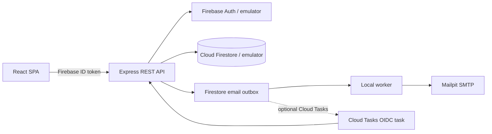

# TicketMaestro

TicketMaestro is an academic event discovery and ticket reservation platform built for **Zarządzanie aplikacjami Internetowymi** at Poznan University of Technology. Its research focus is correctness under concurrency, Firestore transaction contention, latency, and graceful behavior under load.

The repository is a TypeScript monorepo. The React app and Express API are served from one Cloud Run service in production. Firebase Authentication and Cloud Firestore are emulated locally; a separate local email worker delivers to Mailpit.

> Performance numbers in this repository are proposed measurement targets. No benchmark result is claimed until a test has actually been run and its JSON/JTL output retained.

## Features

1. Email/password registration, login, logout, protected routes, and server-enforced `USER`, `MANAGER`, and `ADMIN` roles.
2. Organizer event creation, editing, and deletion with capacity and active-reservation safeguards.
3. Event search, category and date-range filters, title/date sorting, and cursor-based Firestore pagination.
4. Responsive Polish-language event details and live availability checks.
5. Authoritative inventory checks at reservation time; the browser availability display is informational only.
6. Atomic Firestore reservation transactions, 1–5 tickets per request, 409 inventory conflicts, and scoped idempotency keys.
7. Atomic cancellation with ownership checks and one-time ticket restoration.
8. Reservation history, status, cancellation, ticket access, and print-to-PDF confirmation.
9. Simulated purchase verification; no card or payment details are collected. Confirmation emails use a Firestore outbox, local Mailpit, explicit retry, or optional Cloud Tasks delivery. “SIMULATED” means no email was sent.
10. Admin-only dashboard backed by registered user, event, reservation, and inventory records.

The seeded **Noc Świateł** concert has 10 remaining tickets. The separate `load-oversale-event` fixture is resettable and intended for repeatable concurrency experiments.

## Technology

- React 19, TypeScript strict mode, Vite, React Router, TanStack Query, Tailwind CSS 4
- Node.js 22+ (Node 24 LTS in the production container), TypeScript, Express 5, Zod
- Firebase Authentication, Firebase Admin SDK, Cloud Firestore
- pnpm workspaces, ESLint 10, Prettier, Vitest, Supertest, Playwright, k6, Apache JMeter
- Docker Compose, multi-stage Docker build, GitHub Actions

## Architecture



Firestore stores one inventory counter per event. A reservation transaction reads the event and the user-scoped idempotency record, checks current availability, creates one reservation, writes the idempotency mapping, and decrements the event counter. Checkout changes the reservation once and creates up to five ticket documents. Cancellation reads the reservation, event, and any ticket/email-job records and updates the reservation and counter atomically.

An event’s counter is a deliberate hot document under concert-level contention. Firestore transaction retries and contention are part of the experiment; this design does **not** claim a throughput figure. The Cloud Firestore emulator is useful for correctness tests but does not reproduce production latency or contention precisely.

## Repository layout

```text
apps/
  api/                 Express API, Firestore services, seed and local email worker
  web/                 React app, Firebase Auth client, routes and responsive UI
packages/
  shared/              Zod contracts and shared TypeScript types
tests/
  e2e/                 Playwright browser workflows
  performance/k6/      Load, stress, spike, soak, concurrency, failure and purchase tests
  performance/jmeter/  JMeter browse/load/reservation plan and safe runner
scripts/               Local development orchestration
docs/                  Architecture, API, database, deployment, tests and performance notes
```

## Start locally

### Recommended: Docker Compose

Requirements: Docker with Compose v2 and an available port range listed below.

```bash
docker compose up --build
```

This starts Firebase Auth and Firestore emulators, seeds demo users and events, starts Mailpit, runs the local outbox worker, and serves the web app/API. Stop with Ctrl+C. Emulator state is kept in the named `firebase_data` volume.

### Node development

Requirements: Node.js 22+, pnpm 11+, and Java 11+ for the Firebase emulators. Newer Firestore emulator releases may require Java 21; Java 21 is used by the emulator container.

```bash
pnpm install
pnpm dev
```

`pnpm dev` starts Auth and Firestore emulators, builds the shared package, seeds local demo data, then runs the API, Vite app, and local simulation email worker. In this mode the default email adapter is simulation. Use Docker Compose to test SMTP delivery in Mailpit.

### URLs and ports

| Service | URL | Notes |
| --- | --- | --- |
| Web app (Docker) | http://localhost:8080 | Same-origin API in production layout |
| Web app (Vite) | http://localhost:5173 | Proxies `/api` to the API |
| REST API | http://localhost:8080/api | Docker; Vite proxy target |
| Health / readiness | http://localhost:8080/healthz · `/readyz` | Liveness and Firestore readiness |
| OpenAPI JSON | http://localhost:8080/openapi.json | API contract summary |
| Firebase Auth emulator | http://localhost:9099 | Browser SDK connects here locally |
| Firestore emulator | http://localhost:8081 | Admin SDK endpoint |
| Emulator UI | http://localhost:4000 | If enabled by the installed Firebase CLI |
| Mailpit web UI | http://localhost:8025 | Local SMTP inbox |
| Mailpit SMTP | localhost:1025 | No real email delivery |

## Demo accounts

Seeded by both development startup paths. Password for each is `TicketMaestro123!`.

| Role | Email |
| --- | --- |
| User | `user@ticketmaestro.local` |
| Manager | `manager@ticketmaestro.local` |
| Admin | `admin@ticketmaestro.local` |

Registration creates only a `USER`. Role changes are read from Firestore on the server and are never accepted from client registration/profile requests.

## Environment

Copy `.env.example` to `.env` for local overrides. Local startup has safe emulator defaults, so a real Firebase project is not required. The browser Firebase API key is a public client identifier, not a server credential. Never commit service-account JSON or other secrets.

Production Cloud Run should use the service identity with Application Default Credentials. Set the public Firebase web config at build time (`VITE_FIREBASE_API_KEY`, `VITE_FIREBASE_AUTH_DOMAIN`, and `VITE_FIREBASE_PROJECT_ID`) and set `VITE_FIREBASE_AUTH_EMULATOR_URL=` for the production build. Server environment variables and the optional Cloud Tasks settings are documented in [DEPLOYMENT.md](docs/DEPLOYMENT.md).

## Demo data

```bash
pnpm seed                         # local emulator seed; startup already seeds
pnpm seed:load-users              # explicitly create 500 load users
pnpm reset:oversale               # restore load-oversale-event to 10/10
pnpm seed:large                   # explicitly generate the ~10,000-event dataset
```

Seed scripts refuse to run unless both Firebase emulators are configured. Large generation is never automatic. The event capacity range is 10–20,000; no per-seat documents are pre-created.

## Developer commands

```bash
pnpm install
pnpm dev
pnpm build
pnpm lint
pnpm typecheck
pnpm test
pnpm test:integration             # requires Auth and Firestore emulators already running
pnpm test:e2e                     # Playwright starts local emulators/app when needed
E2E_BASE_URL=http://localhost:8080 pnpm test:e2e  # use an already-running Docker Compose app
```

`pnpm test` runs shared/API validation tests and the browser package test suite. The Firebase-backed Supertest suite is skipped unless both emulator host variables are set. See [TEST_CASES.md](docs/TEST_CASES.md) for exact setup and coverage. Heavy k6 tests are not part of CI.

## Performance experiments

All performance scripts default to `http://localhost:8080`. Remote targets are rejected unless `ALLOW_REMOTE_LOAD_TESTS=true`; the 500-user test signs in to the local Auth emulator and requires locally seeded load users.

```bash
pnpm perf:load
pnpm perf:stress
pnpm perf:spike
pnpm perf:soak
pnpm perf:oversale
pnpm perf:multi-event
pnpm perf:failure
pnpm perf:purchase

# Repeatable 500-VU oversale example
pnpm seed:load-users
pnpm reset:oversale
VUS=500 k6 run tests/performance/k6/oversale.js

# JMeter demonstration (after obtaining a local Firebase Auth emulator ID token)
AUTH_TOKEN="$AUTH_TOKEN" tests/performance/jmeter/run-jmeter.sh
```

k6 writes JSON summaries to `tests/performance/results/`. JMeter writes JTL plus an HTML report to a timestamped folder. The expected oversale result is exactly 10 successful holds and 490 `409` inventory conflicts from 500 valid distinct users; the scripts verify the final 10-ticket fixture is fully reserved. No 500-user test is run by CI. Read [PERFORMANCE_TESTING.md](docs/PERFORMANCE_TESTING.md) before using remote targets or changing workload.

## Cloud Run

Deployment documentation targets `europe-west1`, 1 vCPU, 512 MiB, min 0 / max 1 instances, concurrency 10, request-based billing. No cloud resources are created by this repository’s scripts or CI. The manual deployment workflow remains disabled unless explicitly dispatched with its confirmation input and configured Workload Identity Federation. Read [DEPLOYMENT.md](docs/DEPLOYMENT.md) for Firebase, IAM, cost, budget, and deployment details.

Cloud Run’s maximum instance count of 1 is useful for a controlled academic experiment, but it limits throughput and can concentrate work on one instance. Firestore, Cloud Tasks, build, registry/storage, and network usage may still incur charges. Free Trial credits and time limits apply; Cloud Billing budgets and alerts notify but do not cap spend.

## Screenshots

No application screenshots have been captured in this repository yet.

## Troubleshooting

- **Java / Firestore emulator startup:** use Java 21 or run the Docker Compose emulator image; inspect `firebase-debug.log`.
- **Ports in use:** stop old emulator processes or change `firebase.json`, Compose mappings, and `.env` together.
- **Sign-in fails:** confirm the browser uses `http://localhost:9099`, the Auth emulator is running, and `pnpm seed` completed.
- **No role-specific navigation:** sign out and back in; roles are read from the Firestore user profile for each backend request.
- **No email visible:** local Docker uses Mailpit at port 8025. `SIMULATED` status is deliberately not a delivered message.
- **Firestore index prompt in production:** deploy `firestore.indexes.json` to the selected Firebase project and retry after index build completes.
- **Stale oversale fixture:** run `pnpm reset:oversale` against the local emulator before each oversale scenario.
